<div align="center">
  

  # Jameel — Field Workforce & HR Operations App

  **Enterprise-grade Flutter application for field check-ins, tamper-resistant site inspections, HR request workflows, and real-time employee notifications.**

  [](https://flutter.dev)
  [](https://dart.dev)
  [](https://bloclibrary.dev)
  [](https://firebase.google.com)
  [](#-testing--quality-assurance)
  [](#-uiux--design-system)

</div>

---

## Overview

**Jameel** streamlines daily operations for distributed and field teams with an offline-first architecture, strict server-enforced security, and a cohesive bilingual (**Arabic RTL / English LTR**) interface in both **Light** and **Dark** themes.

Built cleanly around **Repository + Cubit (BLoC)** separation, encrypted local persistence (`Hive` + `FlutterSecureStorage`), and role-aware Firebase backend rules (`employee`, `manager`, `hr`).

---

## Key Features

| Module | Capabilities |
|---|---|
| **Authentication & Security** | Email/Password + Google Sign-In (`google_sign_in`), password reset, email verification management, and a custom numpad **App Security PIN** lock with background grace period. |
| **Shift Check-In / Check-Out** | One-tap shift toggle (`check_in` / `check_out`), anti-spoof mock-GPS rejection (`position.isMocked`), configurable work-site **Geofencing**, reverse-geocoded addresses, Today's Shift worked-duration summary, List Timeline (`Today` / `Yesterday` / `Earlier`) & expandable dark-aware Google Map. |
| **Offline-First Sync** | Pending check-ins and site inspections persist locally while offline (preserving original `capturedAt` timestamps) and automatically sync when connectivity returns. |
| **Site Photo Inspections** | Direct camera capture only (gallery picking disabled), automatic footer **Watermark** (`employee name`, timestamp, GPS coordinates, and image resizing), preview / retake / save flow, Firebase Storage upload, and zoomable history (`InteractiveViewer`). |
| **HR Requests & Approvals** | **Leave** (Annual / Sick / Emergency / Unpaid, overlap validation, range picker & live leave balance projection), **Salary Advance** (quick presets + Arabic/Western numeral parsing), **Complaints**, and **Suggestions** — with a 3-step decision timeline, self-cancellation for pending requests, server-side status filtering, and a dedicated **Team Approvals** sheet for `manager` / `hr` roles. |
| **Notifications & Preferences** | Real-time unread count badge synced with per-category notification toggles, search & unread-only filtering, swipe-to-read gestures, batch mark-all-read, watermark privacy toggle, and Light / Dark / System themes. |

---

## Screenshots (English LTR & Arabic RTL)

### 1. Authentication & App Security

| Screen | English (`LTR`) | Arabic (`RTL`) |
|---|:---:|:---:|
| **Sign In** | 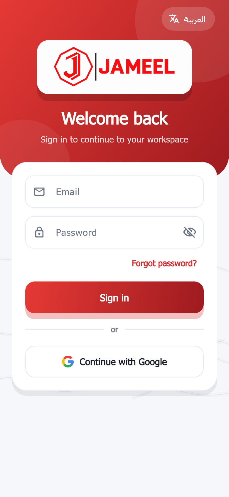 | 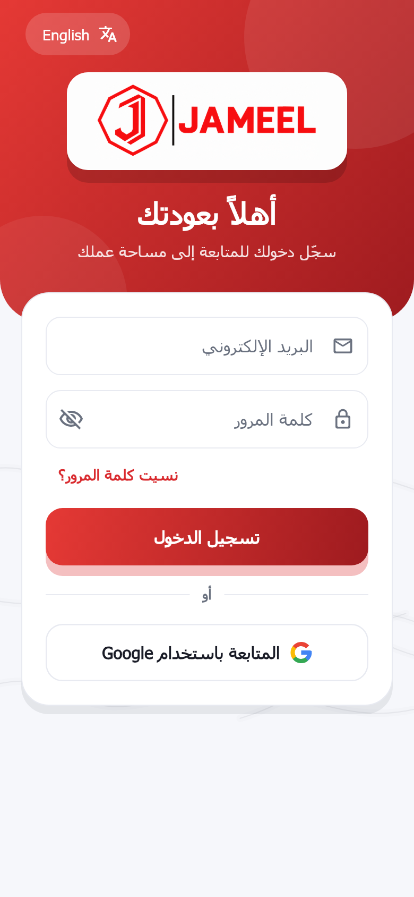 |
| **Security PIN Lock** | 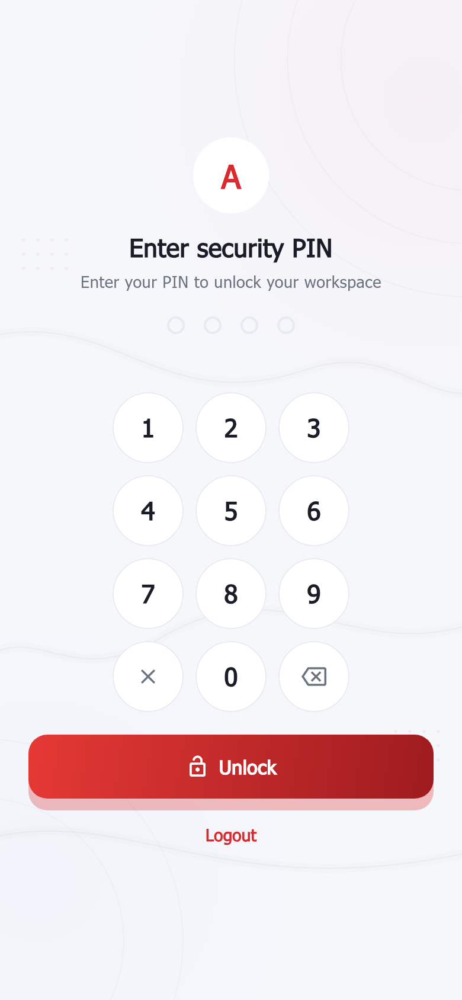 | 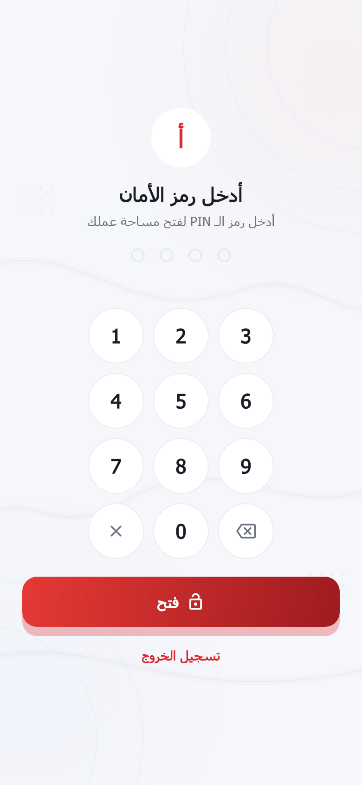 |

### 2. Workforce Home & Field Inspections

| Screen | English (`LTR`) | Arabic (`RTL`) |
|---|:---:|:---:|
| **Home & Attendance** | 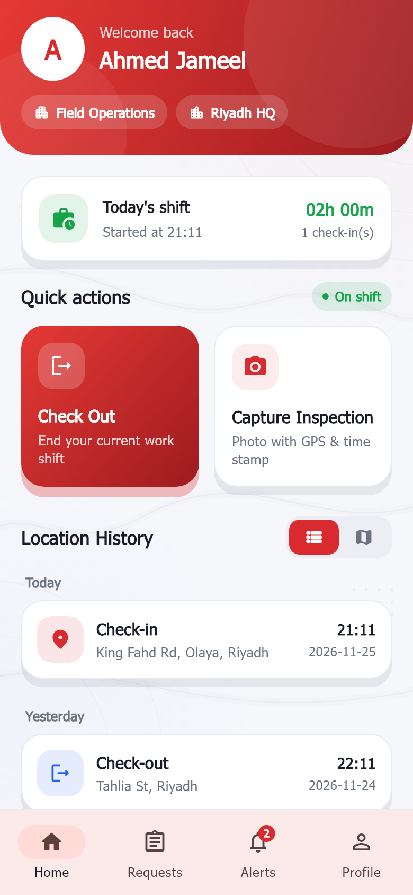 | 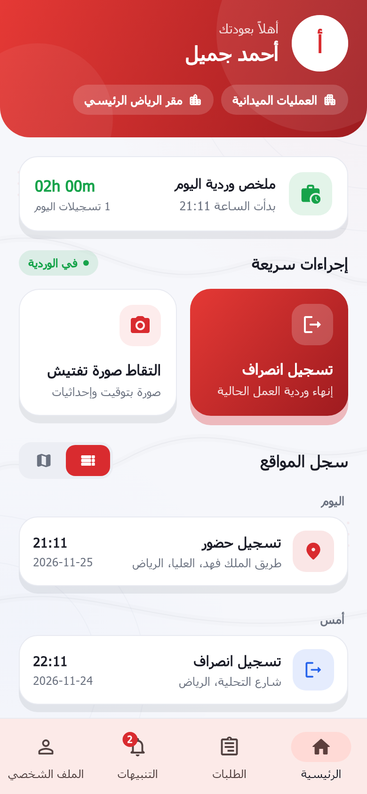 |
| **Site Inspection Capture** | 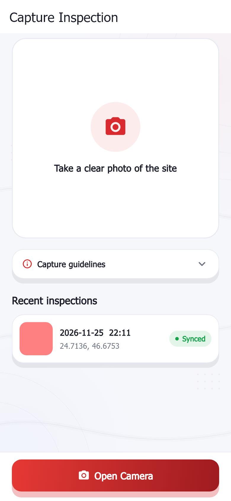 | 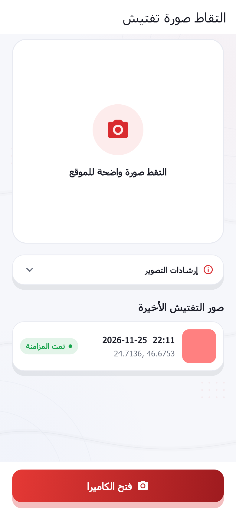 |

### 3. HR Requests & Request Submission

| Screen | English (`LTR`) | Arabic (`RTL`) |
|---|:---:|:---:|
| **Requests Hub** | 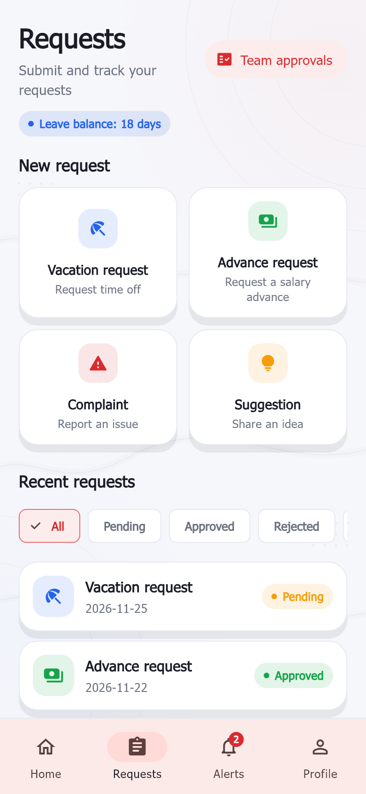 | 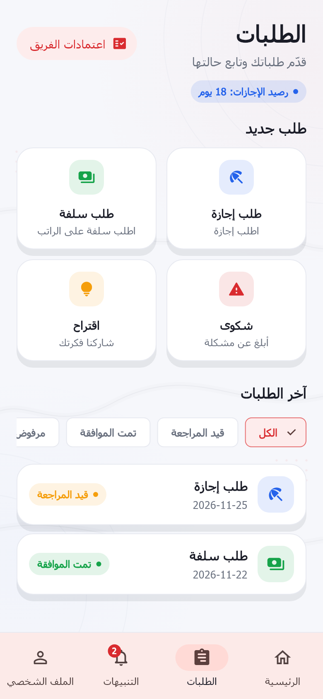 |
| **Request Form** | 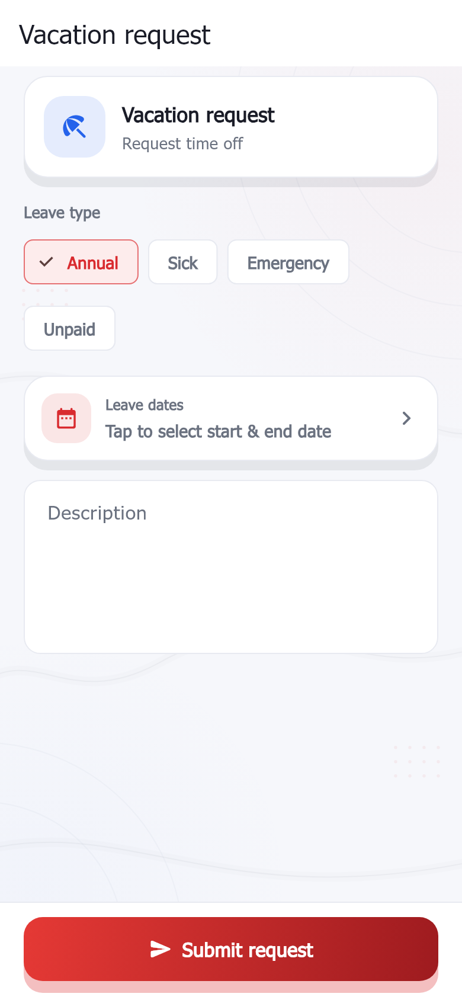 | 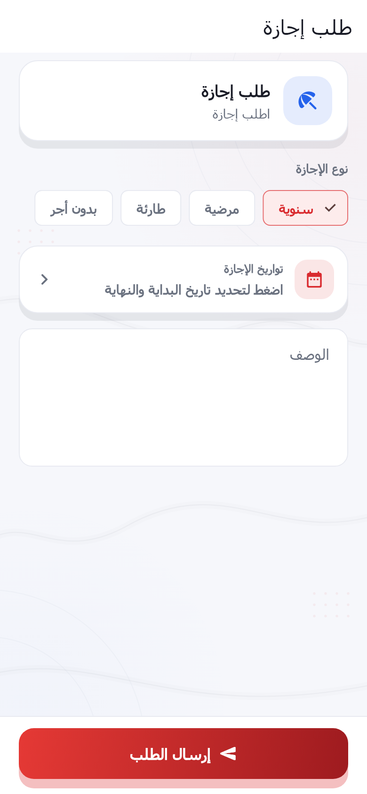 |

### 4. Notifications & Profile Preferences

| Screen | English (`LTR`) | Arabic (`RTL`) |
|---|:---:|:---:|
| **Notifications** | 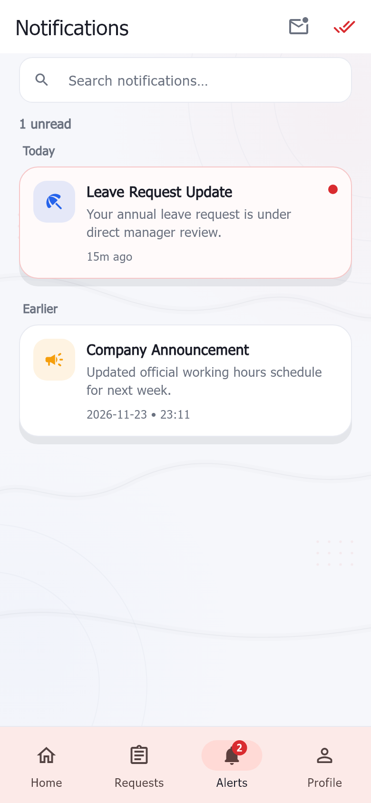 | 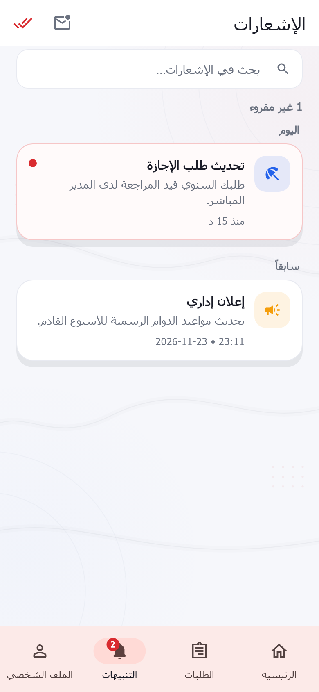 |
| **Profile & Settings** | 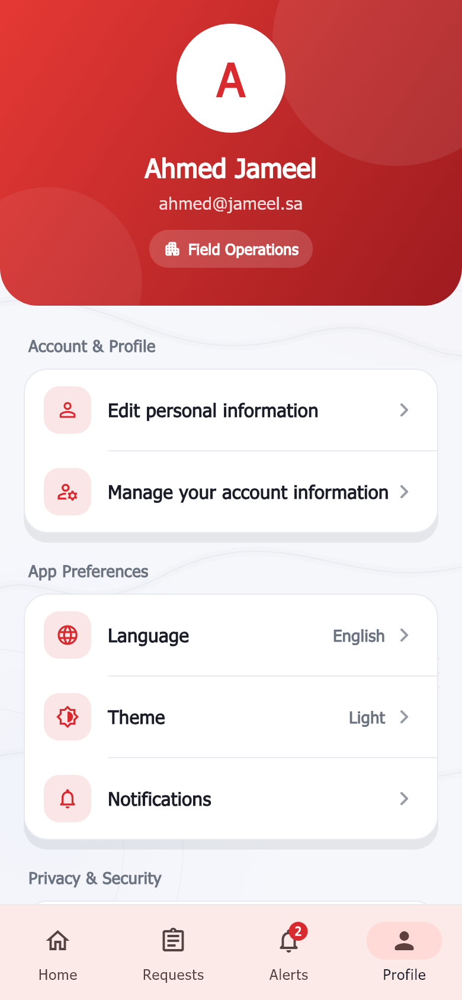 | 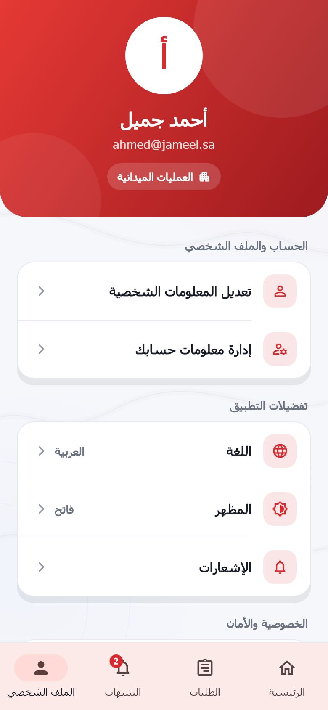 |

---

## Architecture

The codebase follows a **Clean Layered Feature Architecture** where screens depend only on `Cubit` state and never touch Firebase SDKs directly:

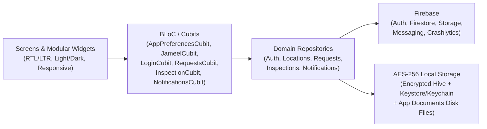

---

## Security & Engineering Highlights

- **Encrypted Local Persistence:** All sensitive Hive boxes (`jameel_cache` and `inspections`) are encrypted via `HiveAesCipher` using a 256-bit random key stored in Android Keystore / iOS Keychain (`flutter_secure_storage`).
- **Hardened App PIN Lock:** Salted **SHA-256** digest (`crypto`) with a per-device CSPRNG 16-byte salt, plus persisted **5-attempt / 30-second cooldown lockout** against brute-force guessing and automatic session PIN cleanup on sign-out.
- **Least-Privilege Firebase Rules:** Granular [`firestore.rules`](firestore.rules) & [`storage.rules`](storage.rules) enforcing strict field allowlisting, client immutability on admin-managed fields (`role`, `annualLeaveBalance`, `assignedSite`, `joinDate`), server-time validation (`request.time`), leave date bounds (`endDate >= startDate`), and owner vs `manager`/`hr` authorization.
- **Release Optimization:** Android release builds configure R8 code shrinking, resource shrinking, and custom Flutter ProGuard keep rules.
- **Zero Memory Leaks & Clean Code Discipline:** Stateful modal sheets properly dispose all `TextEditingController` and `AnimationController` instances; oversized screens are decomposed into focused single-responsibility modules.

---

## UI/UX & Design System

- **Typography:** Locale-aware Google Fonts — **Cairo** for Arabic (`ar`) and **Plus Jakarta Sans** for English (`en`).
- **Brand Language:** Crimson hero surfaces (`#D92B2F` gradient), `#FDFDFD` floating brand containers, crisp `#FFFFFF` / dark-slate `AppCard`s, haptic feedback (`AppHaptics`), and shimmer loading states.
- **Custom Background Ornamentation:** Shared `PageOrnamentBackground` painter rendering subtle architectural corner rings, ambient washes, and silk marble veins inside `RepaintBoundary` layers for smooth scrolling without visual clutter.
- **Full Localization:** `224` synchronized keys across [`en.json`](assets/translations/en.json) and [`ar.json`](assets/translations/ar.json) (`0` missing keys, directional arrows & chevrons across RTL/LTR).

---

## Project Structure

```text
lib/
├── data/repositories/          # Firebase Auth, Firestore, Storage & offline cache repositories
├── layout/                     # Root HomeLayout (IndexedStack + live badge) & JameelCubit
├── models/                     # Domain models (User, LocationCheckIn, Request, Notification)
├── modules/
│   ├── home/                   # Home screen + header, shift summary & location history widgets
│   ├── inspection/             # Camera capture screen, cubit, watermark helper & history UI
│   ├── login/                  # Auth flow, Google button & decorative marble painter
│   ├── notifications/          # Alerts screen & cubit
│   ├── profile_screen/         # Profile settings & modular stateful modal sheets
│   ├── requests_screen/        # Requests hub, 2x2 quick grid, form, details & approvals sheets
│   └── security/               # Custom numpad PIN lock screen with brute-force cooldown
└── shared/
    ├── components/             # Design-system surfaces, inputs, badges, shimmer & dialogs
    ├── cubits/                 # AppPreferencesCubit (theme, prefs, PIN, user session)
    ├── helpers/                # GPS anti-spoofing, distance/geofence & tenure helpers
    ├── network/local/          # AES-256 encrypted CacheHelper
    ├── services/               # PushNotificationsService (FCM permissions & token sync)
    └── styles/                 # Color tokens, shadows & theme-aware extensions
```

---

## Testing & Quality Assurance

Verified on small compact phones (`320×568` with `1.25x` font scaling), standard phones (`390×844`), and tablets (`800×1280`), with automated overflow assertions and CI checks via [GitHub Actions](.github/workflows/flutter_ci.yml):

```bash
flutter analyze   # 0 issues
flutter test      # 31/31 passing unit & multi-screen widget QA tests
```

- [`test/helpers/tenure_helper_test.dart`](test/helpers/tenure_helper_test.dart) — Service tenure edge cases.
- [`test/models/user_model_test.dart`](test/models/user_model_test.dart) — Serialization round-trips & malformed data tolerance.
- [`test/modules/login_cubit_test.dart`](test/modules/login_cubit_test.dart) — Google Sign-In state transitions, cancellation & error mapping.
- [`test/modules/request_meta_test.dart`](test/modules/request_meta_test.dart) — Request type metadata mapping & fallback.
- [`test/modules/requests_cubit_test.dart`](test/modules/requests_cubit_test.dart) — Leave overlap checks, status filter forwarding, cancellation & role-restricted approvals.
- [`test/layout/jameel_cubit_test.dart`](test/layout/jameel_cubit_test.dart) — Offline sync aggregation, bottom nav navigation & secure sign-out cleanup.
- [`test/shared/app_preferences_cubit_test.dart`](test/shared/app_preferences_cubit_test.dart) — Theme/notification persistence, salted SHA-256 PIN & 5-attempt lockout.
- [`test/modules/pin_lock_widget_test.dart`](test/modules/pin_lock_widget_test.dart) — Interactive PIN validation & unlock widget flow.
- [`test/verification/full_ui_qa_test.dart`](test/verification/full_ui_qa_test.dart) — Multi-viewport (`320×568`, `390×844`, `800×1280`), bilingual (`AR`/`EN`) & accessible font-scale QA suite across every screen and bottom sheet.

---

## Getting Started

### Prerequisites
- Flutter SDK (`Dart ^3.13.4`)
- Firebase project with **Authentication** (Email/Password & Google), **Cloud Firestore**, **Firebase Storage**, and **Cloud Messaging** enabled.

### Setup & Run
1. **Install dependencies**
   ```bash
   flutter pub get
   ```
2. **Configure Google Maps API Key (Android)**
   Add your restricted Android Maps key to `android/local.properties` (git-ignored):
   ```properties
   MAPS_API_KEY=YOUR_ANDROID_MAPS_API_KEY
   ```
3. **Configure Firebase (`android/app/google-services.json` & `.firebaserc`)**
   Copy the example templates (or run `flutterfire configure` with your own Firebase project), then deploy Firestore & Storage rules:
   ```bash
   cp .firebaserc.example .firebaserc
   cp android/app/google-services.json.example android/app/google-services.json
   firebase deploy --only firestore,storage
   ```
4. **Run static analysis, tests, or launch on a device**
   ```bash
   flutter analyze
   flutter test
   flutter run
   ```
